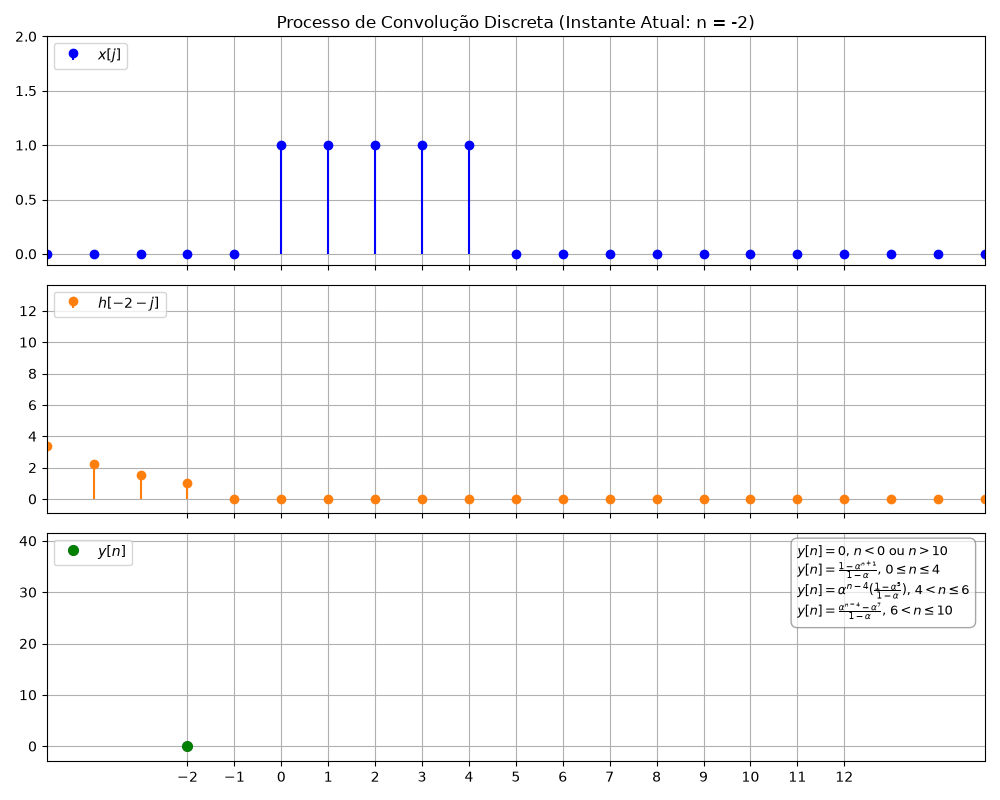

# Simulação Dinâmica de Convolução Discreta

Implementação numérica e visualização animada passo a passo da operação de **convolução em tempo discreto**, baseada no **Exemplo 2.4** do livro *Sinais e Sistemas* (Oppenheim & Willsky, 2ª Ed.).



### O que o projeto demonstra
* **Decomposição gráfica:** Exibição simultânea do sinal fixo $x[j]$, do sinal espelhado e deslocado $h[n - j]$ e da construção acumulada da saída $y[n] = x[n] * h[n]$.
* **Validação analítica:** Comparação visual entre o somatório numérico ponto a ponto e as expressões analíticas definidas por intervalos.

### Tecnologias e Execução
* **Linguagem:** Python 3.x
* **Bibliotecas:** `numpy`, `matplotlib`, `pillow`

```bash
pip install numpy matplotlib pillow
python convolucao_discreta.py
```

